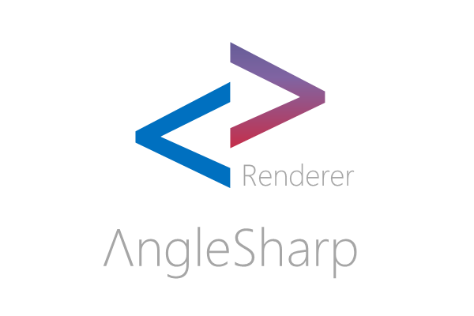

# AngleSharp.Renderer

[](https://github.com/AngleSharp/AngleSharp.Renderer/actions/workflows/ci.yml)
[](https://github.com/AngleSharp/AngleSharp.Renderer/releases)
[](https://www.nuget.org/packages/AngleSharp.Renderer/)
[](https://github.com/AngleSharp/AngleSharp.Renderer/issues)
[](https://cla-assistant.io/AngleSharp/AngleSharp.Renderer)

AngleSharp.Renderer extends the core AngleSharp library with some more powerful rendering capabilities. This repository is the home of the source for the AngleSharp.Renderer NuGet package.

## Current Status

AngleSharp.Renderer lays out and paints HTML, CSS and SVG documents headlessly:

- Block, inline, float, flexbox, grid, table and multi-column layout, positioning (including `sticky`), writing modes and bidirectional text
- Text shaped with HarfBuzz, `@font-face` web fonts (WOFF/WOFF2), bundled fonts for reproducible output
- Backgrounds, gradients, borders, shadows, transforms, filters, masks, blend modes and clipping
- Inline and external SVG, images (also animated GIF/WebP), `<canvas>` with a 2D context, form controls
- An interactive harness for hover, scrolling, text selection, CSS transitions and animations on a virtual clock, plus the CSSOM View geometry APIs (`getBoundingClientRect`, `elementFromPoint`, ...)
- A backend-agnostic display list, rasterized by a SkiaSharp backend to PNG or raw pixels

It is not a full browser: there are no 3D transforms and no paged media, and resources are loaded through AngleSharp's own document loader. See the [documentation](./docs) for details.

## Quick Start

```csharp
using AngleSharp;
using AngleSharp.Css;
using AngleSharp.Renderer;

var device = new DefaultRenderDevice { ViewPortWidth = 800, ViewPortHeight = 450 };
var config = Configuration.Default.WithCss().WithRenderDevice(device).WithRendering();
var context = BrowsingContext.New(config);
var document = await context.OpenAsync(req => req.Content(@"
<html>
	<body>
		<h1>Hello Renderer</h1>
		<p>This page was rendered by AngleSharp.Renderer.</p>
	</body>
</html>"));

var image = document.RenderToPng();

await File.WriteAllBytesAsync("render.png", image.Data);
```

The render device's viewport is the size of the image; without one, documents render at 800×600. `RenderToImage` takes `RenderOptions` for full-page, clipped, element and HiDPI captures, and for JPEG or WebP:

```csharp
var page = document.RenderToImage(new RenderOptions { FullPage = true, DeviceScaleFactor = 2f });
var card = document.QuerySelector(".card")!.RenderToImage();
```

`WithRendering()` adds support for `<canvas>` elements (with a 2D drawing context) and for `` data.

## Design Direction

The current architecture is intentionally split into two layers:

- Core: DOM/CSS integration, layout model, display-list generation
- Backend: rasterization (currently SkiaSharp)

This keeps future work open for additional backends and interactive rendering scenarios.

## .NET Foundation

This project is supported by the [.NET Foundation](https://dotnetfoundation.org).

## License

AngleSharp.Renderer is released using the MIT license. For more information see the [license file](./LICENSE).
